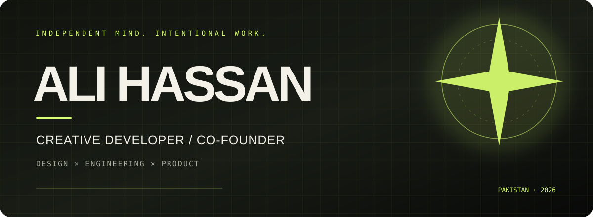
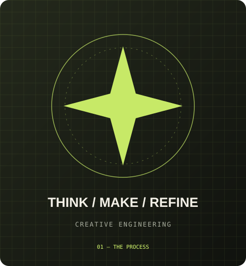
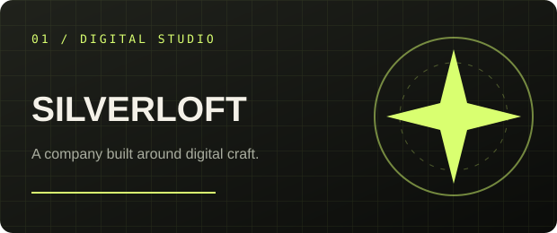
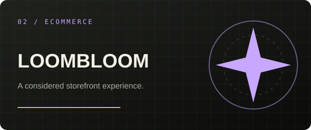
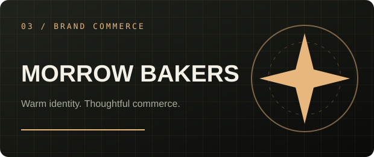
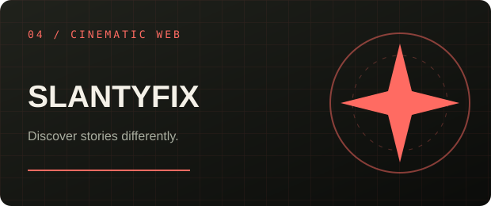
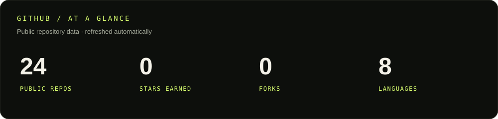
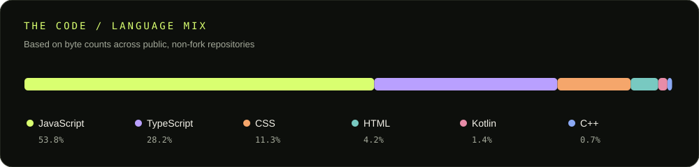
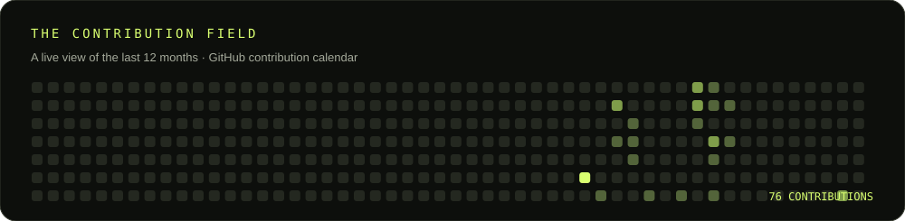
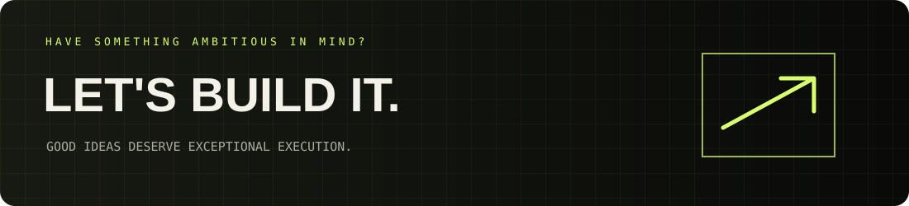

 

  

**I turn ambitious ideas into digital experiences people remember.**

CREATIVE DEVELOPMENT&nbsp; / &nbsp;FRONTEND ENGINEERING&nbsp; / &nbsp;PRODUCT THINKING

---

<table>
<tr>
<td width="58%" valign="top">

## 01 — A LITTLE ABOUT ME

I'm **Ali Hassan** — a developer, UI/UX enthusiast and Co-Founder of **SilverLoft**.

I care about the space where design meets engineering: clear interfaces, thoughtful interactions, strong visual systems and products that work as beautifully as they look.

My strongest focus is frontend engineering, while I continue building across the full stack.

**Currently focused on**
- Building digital products at SilverLoft
- React and Next.js engineering
- Interface design, motion and interaction
- Backend integration and database fundamentals
- C++, OOP and data structures

> Good design gets attention. Good engineering earns trust.

</td>
<td width="42%" valign="middle" align="center">

DESIGN WITH INTENT. BUILD WITH PURPOSE.

</td>
</tr>
</table>

## 02 — THE TOOLBOX

CORE FOCUS: React · Next.js · JavaScript · TypeScript · Tailwind CSS · Node.js · Firebase · MongoDB

---

## 03 — SELECTED WORK

A few directions I've explored — from commerce and company building to cinematic discovery and systems fundamentals.

<table>
<tr>
<td width="50%" valign="top">

### 01 / SilverLoft

**A software studio with a point of view.**

Co-founding a digital product company focused on thoughtful web experiences and modern software solutions.

`NEXT.JS` `REACT` `TAILWIND` `MOTION`

<a href="https://silverloft.me">VISIT SILVERLOFT ↗</a>

</td>
<td width="50%" valign="top">

### 02 / LoomBloom

**Commerce, made considered.**

An e-commerce storefront with product discovery, cart functionality and Firebase-backed data.

`REACT` `VITE` `FIREBASE`

<a href="https://loombloom.vercel.app/">EXPLORE PROJECT ↗</a>

</td>
</tr>
<tr>
<td width="50%" valign="top">

### 03 / Morrow Bakers

**A warm digital storefront.**

A bakery-focused commerce experience with a distinctive visual identity and product-led presentation.

`NEXT.JS` `REACT` `TAILWIND`

<a href="https://bakemarkey.vercel.app/">VIEW LIVE ↗</a>

</td>
<td width="50%" valign="top">

### 04 / Slantyfix

**A more cinematic way to discover.**

A movie discovery experience exploring cinematic presentation, API-driven content and frontend interaction.

`NEXT.JS` `API INTEGRATION` `UI/UX`

</td>
</tr>
</table>

<strong>MORE IN THE WORKSHOP — SYSTEMS & DATABASES</strong>

**Student Record Management System**  
C++ CRUD application using structures, arrays, searching, sorting and binary-file persistence.

`C++` `OOP` `FILE I/O`

**MongoDB Practice Lab**  
Hands-on exploration of CRUD, queries, projections, pagination, embedded documents and aggregation pipelines.

`MONGODB` `AGGREGATION` `SCHEMA DESIGN`

---

## 04 — GITHUB, WITHOUT THE GUESSWORK

These cards are generated from GitHub's API by this repository's own scheduled workflow — no third-party stats-card service required.

  

  

---

## 05 — WHAT I'M ABOUT

<table>
<tr>
<td width="33%" valign="top">

### / DESIGN

Interfaces with hierarchy, rhythm, clarity and personality.

</td>
<td width="33%" valign="top">

### / ENGINEERING

Maintainable components, useful architecture and reliable functionality.

</td>
<td width="33%" valign="top">

### / CURIOSITY

Learning by building, testing ideas and improving the details.

</td>
</tr>
</table>

---

 

<a href="https://github.com/Ali-Hassan87">GITHUB</a>
&nbsp; / &nbsp;
<a href="https://silverloft.me">SILVERLOFT</a>
&nbsp; / &nbsp;
<a href="mailto:silverloft111@gmail.com">EMAIL</a>

  

© ALI HASSAN · BUILT WITH CURIOSITY AND CODE.

